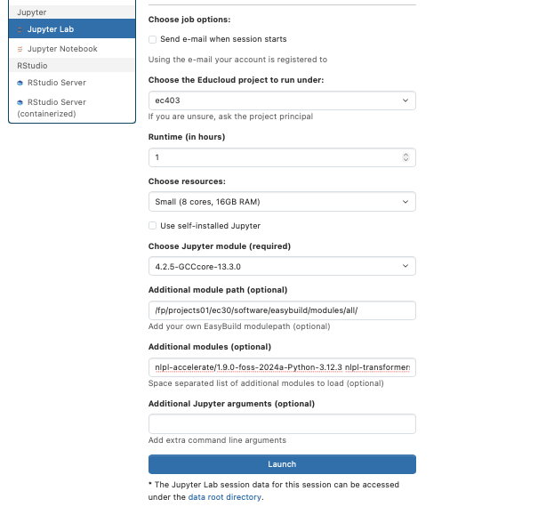

## Fox description for Part 2

### Choose the Educloud project to run under:
ec403

### Choose Jupyter module:
4.2.5-GCCcore-13.3.0


#### Additional module path:

```/fp/projects01/ec30/software/easybuild/modules/all/```

#### Additional modules:


```nlpl-accelerate/1.9.0-foss-2024a-Python-3.12.3 nlpl-transformers/4.55.4-foss-2024a-Python-3.12.3 nlpl-pytorch/2.6.0-foss-2024a-cuda-12.6.0-Python-3.12.3 nlpl-nlptools/01-foss-2024a-Python-3.12.3 nlpl-datasets/3.6.0-foss-2024a-Python-3.12.3 nlpl-python-candy/01-foss-2024a-Python-3.12.3 nlpl-sentencepiece/0.2.1-foss-2024a-Python-3.12.3 nlpl-huggingface-hub/0.34.4-foss-2024a-Python-3.12.3```


### Example:


